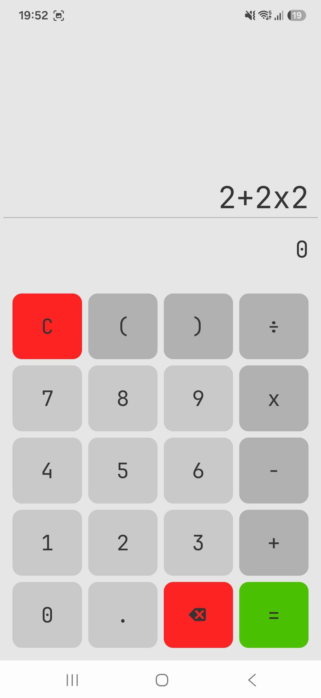
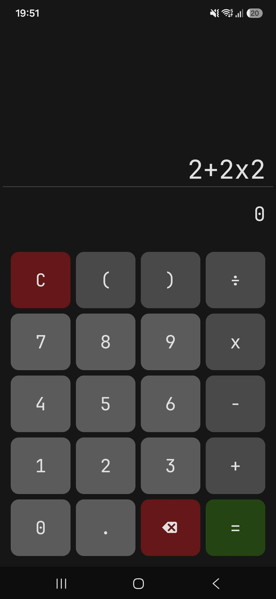
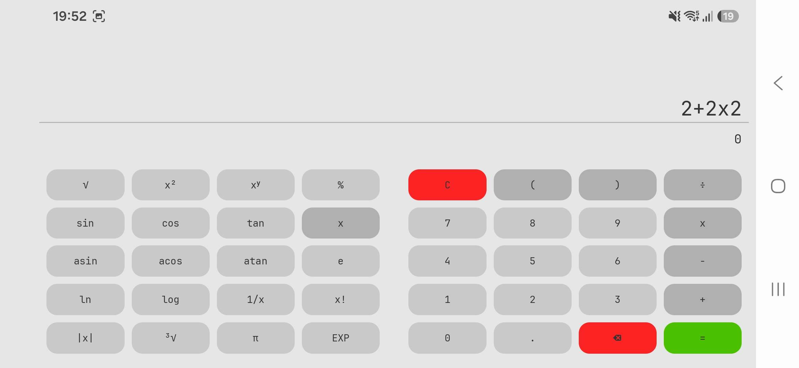
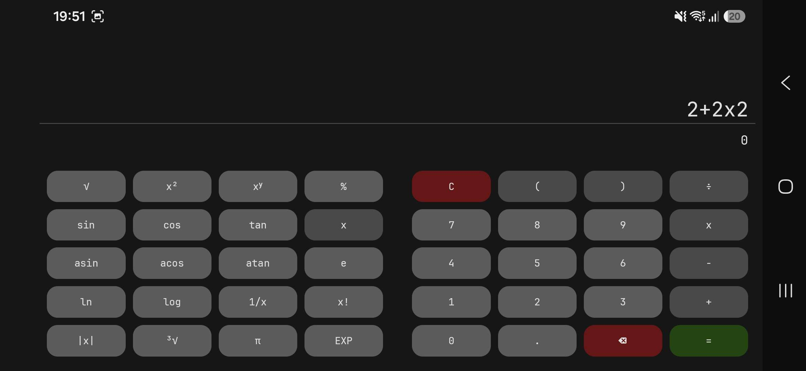
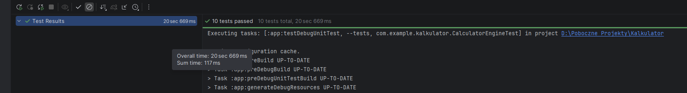

# 🧮 Kalkulator - Jetpack Compose

Nowoczesna, responsywna aplikacja kalkulatora dla systemu Android, zbudowana od podstaw z wykorzystaniem **Jetpack Compose** oraz **Material Design 3**. 
Projekt demonstruje zaawansowane zarządzanie układem, wsparcie dla orientacji poziomej ekranu oraz niestandardową obsługę motywów w architekturze nowoczesnych aplikacji mobilnych.

## 📸 Zrzuty ekranu

  <h3>Tryb Pionowy (Podstawowy)</h3>
  
  

  <h3>Tryb Poziomy (Naukowy)</h3>
  
  

## Główne funkcjonalności

* **Adaptacyjny interfejs (Responsive UI):** Płynne skalowanie elementów (wyeliminowanie sztywnych wartości `dp`), dzięki czemu aplikacja idealnie wypełnia przestrzeń na ekranach o różnych proporcjach (zarówno telefony, jak i tablety).

* **Tryb naukowy (Landscape Mode):** Wykrywanie obrotu urządzenia (`LocalConfiguration`) i płynne przejście do trybu poziomego z dodatkowym panelem funkcji naukowych (trygonometria, logarytmy, stałe).

* **Pełna obsługa Dark/Light Mode:** Integracja z systemowym motywem w oparciu o semantyczne role kolorystyczne Material Design 3.

* **Dynamiczne skalowanie tekstu:** Pole wyniku automatycznie zmniejsza wielkość czcionki wraz z długością wprowadzanego równania (oraz limituje wiersze), zapobiegając ucinaniu znaków.

## Odpowiedzi na pytania do sprawozdania (Decyzje architektoniczne)

Podczas realizacji projektu rygorystycznie trzymano się dobrych praktyk inżynierii oprogramowania oraz wytycznych z konspektu laboratoryjnego:

### Architektura UI bez duplikacji kodu (Zasada DRY)

Aby uniknąć podwójnego implementowania siatki dla orientacji pionowej i poziomej, zrezygnowano z pisania oddzielnych widoków. Stworzono pojedynczy, generyczny komponent `@Composable fun Keyboard`, który przyjmuje strukturę klawiszy (listę list) jako parametr. Kod renderujący klawiaturę podstawową i rozszerzoną to fizycznie ten sam, wielokrotnego użytku fragment logiki.

### Dlaczego przycisk π powinien wpisywać nazwę stałej, a nie liczbę 3,14159?

Kalkulator zaprojektowano z myślą o precyzyjnym silniku matematycznym. Z tego powodu **przycisk stałej `π` celowo wprowadza do pola tekstowego swój symbol (nazwę stałej), a nie przybliżenie dziesiętne**. 
Zamiana na ucięte przybliżenie już na etapie wpisywania z UI skutkuje nieodwracalną utratą dokładności. Właściwa podmiana na stałą o najwyższej precyzji (np. `Math.PI`) następuje dopiero w parserze podczas finalnej ewaluacji wyrażenia.

### Dlaczego wybrany został ten konkretny kolor bazowy?

Schemat kolorystyczny zbudowano tak, by zapewnić intuicyjność i rygorystycznie spełnić normy kontrastu WCAG (powyżej 4,5:1):
Wybrano wyrazisty odcień **zieleni** (Primary) i przypisano go do najważniejszego przycisku – znaku równości (`=`), ponieważ intuicyjnie kojarzy się on z zatwierdzeniem operacji. Zieleń ta została wyraźnie skontrastowana z intensywną **czerwienią** przypisaną wyłącznie do akcji destrukcyjnych (czyszczenie `C` oraz usuwanie znaku `⌫`). Takie przypisanie ról wizualnych bezpiecznie dzieli klawiaturę na strefy funkcyjne i ułatwia nawigację w trybie jasnym i ciemnym.

## 🛠 Technologie (Tech Stack)

* **Język:** Kotlin
* **UI Toolkit:** Jetpack Compose
* **Design System:** Material Design 3 (Material Theme)
* **Środowisko:** Android Studio Quail (API 37)

---

## Rozszerzenie funkcjonalne i testy (Konspekt 5)

### 1. Zachowanie stanu przy zmianie orientacji (`rememberSaveable` i `Bundle`)

* **Różnica między `remember` a `rememberSaveable`:** Zwykłe `remember` przechowuje stan wyłącznie w pamięci operacyjnej kompozycji. Przy zmianie orientacji ekranu system Android niszczy bieżącą instancję `MainActivity` i tworzy ją od nowa, przez co dane z `remember` bezpowrotnie przepadają. Zastosowanie `rememberSaveable` rozwiązuje ten problem — pod spodem mechanizm ten serializuje stan (`formula` oraz `result`) do dokładnie tego samego obiektu `Bundle`, który aktywność otrzymuje w cyklu życia w metodzie `onSaveInstanceState(outState: Bundle)`.
* **Weryfikacja empiryczna:** Nadpisanie `onSaveInstanceState` i wypisanie kluczy obiektu `Bundle` w Logcat potwierdziło zapisanie rejestru stanu Compose (`androidx.lifecycle.BundlableSavedStateRegistry.key`) podczas obrotu emulatora.

### 2. Silnik obliczeniowy (`mXparser`) i kwestie licencyjne

* **Architektura:** Logika matematyczna została całkowicie oddzielona od warstwy interfejsu (`Jetpack Compose`) i zamknięta w czystej klasie Kotlinowej `CalculatorEngine`. Brak odwołań do `Context` oraz zasobów Androida umożliwia uruchamianie szybkich, lokalnych testów jednostkowych JUnit bezpośrednio na JVM bez konieczności uruchamiania emulatora.
* **Zależności i licencja:** Biblioteka `org.mariuszgromada.math:MathParser.org-mXparser:6.1.1` została podpięta poprzez katalog wersji (`gradle/libs.versions.toml`). Biblioteka udostępniana jest na **licencji podwójnej** — darmowej do zastosowań niekomercyjnych (w tym dydaktycznych) oraz płatnej w przypadku wykorzystania komercyjnego. Zgodnie z wymogami licencji w bloku inicjalizacyjnym silnika zadeklarowano charakter użycia metodą `License.iConfirmNonCommercialUse(...)`.
* **Odporność na błędy:** Biblioteka `mXparser` nie rzuca wyjątków przy błędach matematycznych, lecz zwraca wartość specjalną `Double.NaN`. Wyrażenia niedokończone lub z niedomkniętymi nawiasami są odfiltrowywane przed obliczeniem (zwracając pusty wynik bez błędu), natomiast błędy dziedziny i dzielenie przez zero są przechwytywane przez sprawdzenie `.isNaN()` i prezentowane jako czytelny komunikat z zasobów (`strings.xml`).

### 3. Wyniki testów (Tabela przypadków i testy jednostkowe JUnit)

Wszystkie przypadki brzegowe zostały zweryfikowane zarówno manualnie w aplikacji, jak i automatycznie za pomocą lokalnych testów jednostkowych w `CalculatorEngineTest`:

| Wprowadzone wyrażenie | Czego dotyczy | Zachowanie aplikacji i wynik testu |
| :--- | :--- | :--- |
| `2+2*2` | Kolejność działań | Zwraca poprawny wynik `6` (mnożenie ma wyższy priorytet niż dodawanie). |
| `(2+2)*2` | Nawiasy | Zwraca poprawny wynik `8` (nawiasy wymuszają kolejność). |
| `1/0` | Dzielenie przez zero | Brak awarii aplikacji; wyświetlany jest przetłumaczony komunikat błędu (`Błąd obliczeń`). |
| `2+` | Wyrażenie niedokończone | Brak awarii aplikacji; pole wyniku pozostaje puste do czasu dokończenia działania. |
| `((2+2)` | Nawias niezamknięty | Brak awarii aplikacji; weryfikacja balansu nawiasów wstrzymuje obliczenie (brak wyniku). |
| *(puste pole)* | Stan początkowy | Brak wyniku oraz brak komunikatu o błędzie. |
| `√(-1)` / `sqrt(-1)` | Dziedzina funkcji | Brak awarii aplikacji; wynik `NaN` przechwycony i zamieniony na komunikat błędu. |
| `1234567890*1234567890` | Duże liczby | Wynik formatowany do notacji naukowej (`1.524158E18`), dzięki czemu nie rozjeżdża układu ekranu. |
| `2,5+1` oraz `2.5+1` | Separator dziesiętny | Przecinek jest automatycznie normalizowany na kropkę przed obliczeniem; oba warianty zwracają `3.5`. |

#### Zrzuty ekranu z weryfikacji (Testy jednostkowe JUnit)

  <h4>Lokalne testy jednostkowe (CalculatorEngineTest)</h4>
  

### 4. Dopracowanie detali (UI/UX)

* **Typografia tabelaryczna:** Zastosowano krój o stałej szerokości znaków (*JetBrains Mono*), co eliminuje poziome „drganie” cyfr na wyświetlaczu podczas szybkiego wprowadzania kolejnych znaków.
* **Ikona i lokalizacja:** Przygotowano własną ikonę adaptacyjną aplikacji wraz z warstwą monochromatyczną oraz zlokalizowano wszystkie teksty interfejsu w plikach `res/values/strings.xml` (język polski) i `res/values-en/strings.xml` (język angielski).

*Projekt zrealizowany w ramach przedmiotu Programowanie Systemów Mobilnych.*