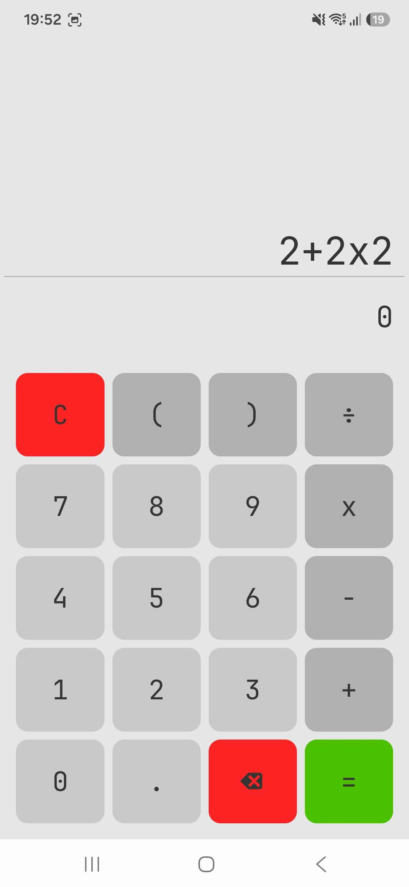
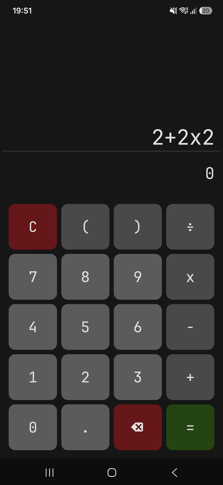
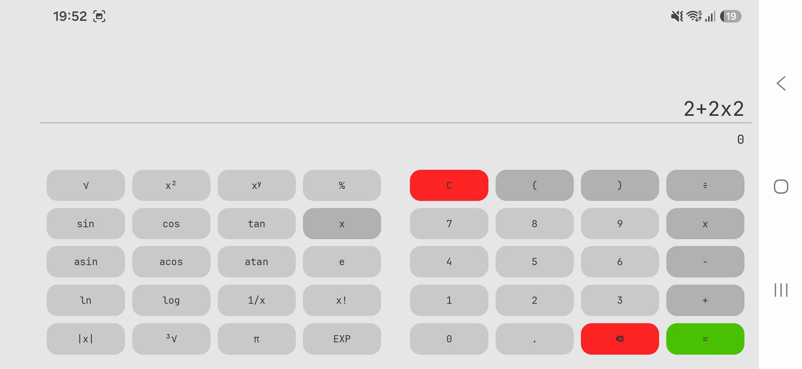
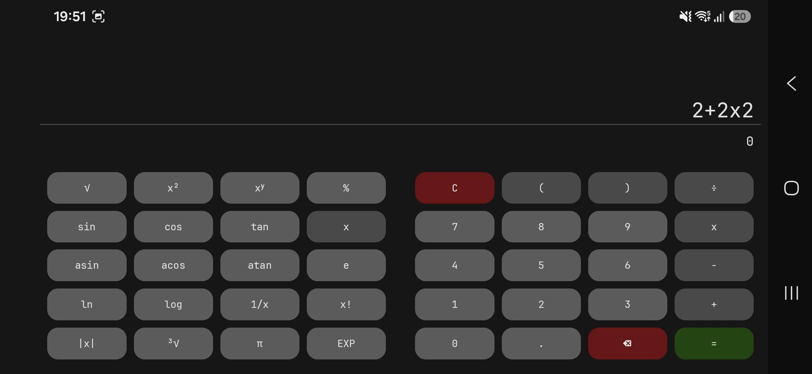

# 🧮 Kalkulator - Jetpack Compose

Nowoczesna, responsywna aplikacja kalkulatora dla systemu Android, zbudowana od podstaw z wykorzystaniem **Jetpack Compose** oraz **Material Design 3**. 
Projekt demonstruje zaawansowane zarządzanie układem, wsparcie dla orientacji poziomej ekranu oraz niestandardową obsługę motywów w architekturze nowoczesnych aplikacji mobilnych.

## 📸 Zrzuty ekranu

  <h3>Tryb Pionowy (Podstawowy)</h3>
  
  

  <h3>Tryb Poziomy (Naukowy)</h3>
  
  

## Główne funkcjonalności

* **Adaptacyjny interfejs (Responsive UI):** Płynne skalowanie elementów (wyeliminowanie sztywnych wartości `dp`), dzięki czemu aplikacja idealnie wypełnia przestrzeń na ekranach o różnych proporcjach (zarówno telefony, jak i tablety).

* **Tryb naukowy (Landscape Mode):** Wykrywanie obrotu urządzenia (`LocalConfiguration`) i płynne przejście do trybu poziomego z dodatkowym panelem funkcji naukowych (trygonometria, logarytmy, stałe).

* **Pełna obsługa Dark/Light Mode:** Integracja z systemowym motywem w oparciu o semantyczne role kolorystyczne Material Design 3.

* **Dynamiczne skalowanie tekstu:** Pole wyniku automatycznie zmniejsza wielkość czcionki wraz z długością wprowadzanego równania (oraz limituje wiersze), zapobiegając ucinaniu znaków.

## Odpowiedzi na pytania do sprawozdania (Decyzje architektoniczne)

Podczas realizacji projektu rygorystycznie trzymano się dobrych praktyk inżynierii oprogramowania oraz wytycznych z konspektu laboratoryjnego:

### Architektura UI bez duplikacji kodu (Zasada DRY)

Aby uniknąć podwójnego implementowania siatki dla orientacji pionowej i poziomej, zrezygnowano z pisania oddzielnych widoków. Stworzono pojedynczy, generyczny komponent `@Composable fun Keyboard`, który przyjmuje strukturę klawiszy (listę list) jako parametr. Kod renderujący klawiaturę podstawową i rozszerzoną to fizycznie ten sam, wielokrotnego użytku fragment logiki.

### Dlaczego przycisk π powinien wpisywać nazwę stałej, a nie liczbę 3,14159?

Kalkulator zaprojektowano z myślą o precyzyjnym silniku matematycznym. Z tego powodu **przycisk stałej `π` celowo wprowadza do pola tekstowego swój symbol (nazwę stałej), a nie przybliżenie dziesiętne**. 
Zamiana na ucięte przybliżenie już na etapie wpisywania z UI skutkuje nieodwracalną utratą dokładności. Właściwa podmiana na stałą o najwyższej precyzji (np. `Math.PI`) następuje dopiero w parserze podczas finalnej ewaluacji wyrażenia.

### Dlaczego wybrany został ten konkretny kolor bazowy?

Schemat kolorystyczny zbudowano tak, by zapewnić intuicyjność i rygorystycznie spełnić normy kontrastu WCAG (powyżej 4,5:1):
Wybrano wyrazisty odcień **zieleni** (Primary) i przypisano go do najważniejszego przycisku – znaku równości (`=`), ponieważ intuicyjnie kojarzy się on z zatwierdzeniem operacji. Zieleń ta została wyraźnie skontrastowana z intensywną **czerwienią** przypisaną wyłącznie do akcji destrukcyjnych (czyszczenie `C` oraz usuwanie znaku `⌫`). Takie przypisanie ról wizualnych bezpiecznie dzieli klawiaturę na strefy funkcyjne i ułatwia nawigację w trybie jasnym i ciemnym.

## 🛠 Technologie (Tech Stack)

* **Język:** Kotlin
* **UI Toolkit:** Jetpack Compose
* **Design System:** Material Design 3 (Material Theme)
* **Środowisko:** Android Studio Quail (API 37)

*Projekt zrealizowany w ramach przedmiotu Programowanie Systemów Mobilnych.*